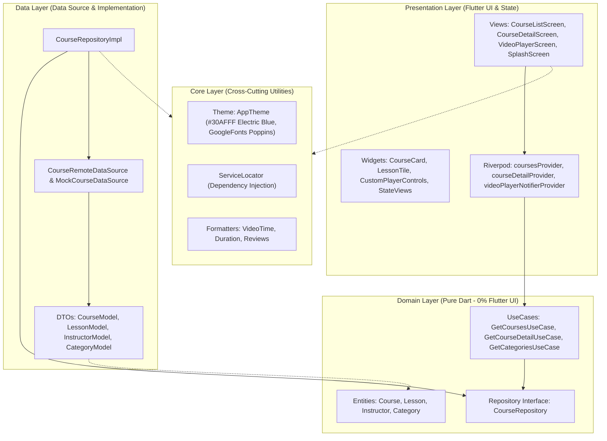
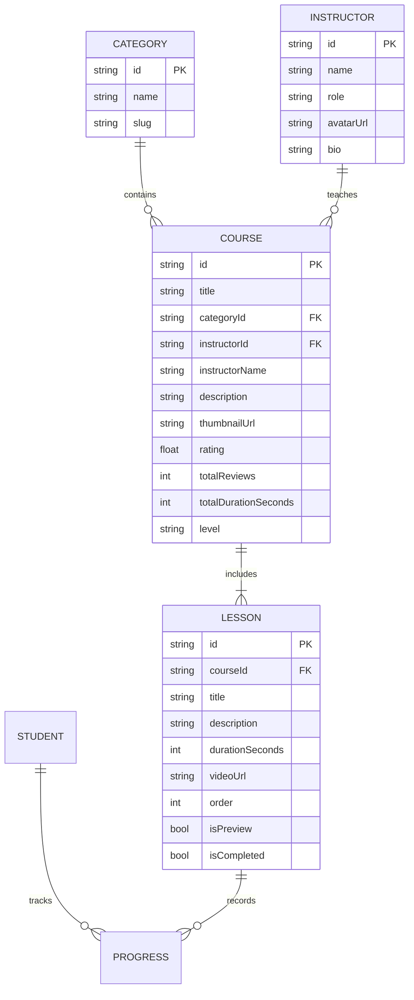
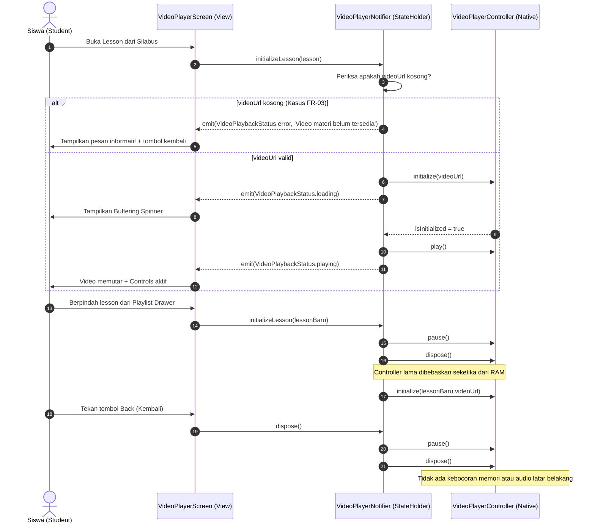

# SYSTEM DESIGN & UI/UX SPECIFICATION: LUMA E-LEARNING
**Dokumen Pendamping PRD (Product Requirements Document)**  
**Version:** 1.0 • **Platform:** Mobile Application (Flutter & Dart) • **Track:** Flutter Developer – Track B  

---

## 1. Pemetaan Kebutuhan PRD & Kriteria Acceptance (FR-01 s/d FR-06)

Berdasarkan `PRD.md`, aplikasi dirancang sebagai aplikasi *Student-only* yang berfokus pada alur intuitif:
`Course List → Course Detail → Select Lesson → Video Player → Playback & Navigation`.

| ID PRD | Fitur | Status | Detail Implementasi di Aplikasi Luma |
|---|---|---|---|
| **FR-01** | **Course List** | Terpenuhi | Menampilkan thumbnail, judul, *short description*, nama instruktur, total pelajaran, estimasi durasi, dan rating. Memiliki *loading state* (shimmer/spinner), *empty state*, dan *error state* dengan tombol *Retry*. |
| **FR-02** | **Course Detail** | Terpenuhi | Banner hero, judul course, instruktur, total lesson, deskripsi komprehensif, indikator kemajuan belajar (*progress bar*), dan silabus pelajaran berurutan. |
| **FR-03** | **Lesson List & Selection** | Terpenuhi | Menampilkan nomor urut lesson, judul, durasi, status selesai, dan badge pratinjau. Jika lesson tidak memiliki URL video, sistem menampilkan badge `Segera Hadir` dan pesan informatif saat dibuka tanpa menyebabkan *error/crash*. |
| **FR-04** | **Video Player** | Terpenuhi | Pemutaran streaming video MP4/HLS yang stabil dengan controller native `video_player`. Dilengkapi kontrol: *Play*, *Pause*, *Seek slider* interaktif, Skip -10s/+10s, dan pengatur kecepatan (*speed multiplier* 0.75x–2.0x). Menangani *loading/buffering state*, *error retry*, dan pelepasan memori (*safe disposal*). |
| **FR-05** | **Navigation** | Terpenuhi | Alur navigasi mulus tanpa penumpukan stack yang tidak perlu: *Course List → Course Detail → Video Player → Course Detail*, serta fitur *playlist bottom sheet* untuk berpindah lesson langsung di dalam pemutar video. Tombol kembali (*Back button*) tetap selalu aktif dalam kondisi apa pun (bahkan saat loading atau error). |
| **FR-06** | **State Handling** | Terpenuhi | Penanganan komprehensif untuk seluruh kondisi: **Loading**, **Success**, **Empty**, **Error**, dan **Network Failure** (*timeout/offline retry*). |

---

## 2. Arsitektur Sistem (Clean Architecture)

Mengikuti rekomendasi Section 8 pada `PRD.md` dan standar enterprise blueprint:

---

## 3. Desain Model Data & ERD (Sesuai Section 7 PRD)

---

## 4. Alur Interaksi & Diagram Sequence Pemutar Video

---

## 5. UI/UX Design System Specification

### 5.1. Spesifikasi Penggunaan Warna (Color Usage Table)
| Element | Color Hex | Peruntukan & Implementasi di Kode |
|---|---|---|
| **Primary button** | `#2563EB` | `AppTheme.primaryButton`, Tombol utama ("Mulai Belajar", "Berikutnya") |
| **Secondary button** | `#DBEAFE` | `AppTheme.secondaryButton`, Tombol sekunder ("Sebelumnya"), pill badge kategori |
| **App background** | `#F8FAFC` | `AppTheme.appBackground`, Latar belakang seluruh halaman aplikasi |
| **Card** | `#FFFFFF` | `AppTheme.card`, Latar belakang kartu course, sheet dialog, input field |
| **Heading** | `#0F172A` | `AppTheme.heading`, Teks judul halaman, header course, teks tebal |
| **Body text** | `#475569` | `AppTheme.bodyText`, Deskripsi materi, ulasan, subtitle informatif |
| **Icon active** | `#2563EB` | `AppTheme.iconActive`, Ikon status aktif, play button, navigasi aktif |
| **Icon inactive** | `#94A3B8` | `AppTheme.iconInactive`, Ikon non-aktif, chevron trailing, placeholder |
| **Progress bar** | `#60A5FA` | `AppTheme.progressBar`, Indikator kemajuan belajar & seek bar video |

- **Splash Screen:** Slate Dark `#0F172A` dengan konfigurasi Android *Single-Stage Anti-Double Splash*.
- **Tipografi:** Google Fonts `Poppins` dengan hierarki Display (24px), Title (18px), Subtitle (14px), Body (12.5px), Caption (11px).
- **Aturan Bebas Emoji Gimmick:** Seluruh antarmuka menggunakan ikon resmi `Icons.xxx` dari Material Icons.
